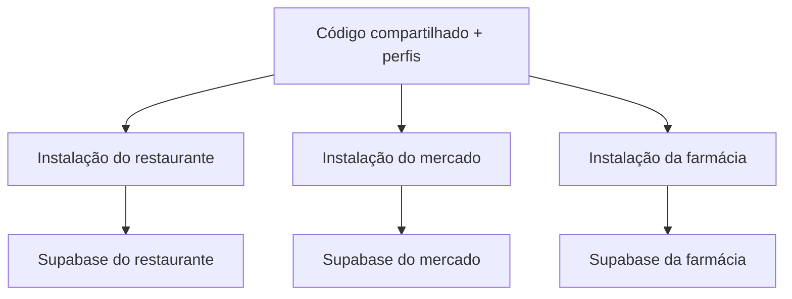

# Arquitetura e reutilização

## Produto comercial

O estabelecimento recebe sua loja, domínio e painel de atendimento. A implantação pode ser cobrada como projeto e a manutenção como serviço recorrente; preço e contrato dependem do escopo acertado com cada cliente. A marca do fornecedor não aparece na vitrine. Esta base não adiciona uma plataforma de assinatura por trás.

## Separação escolhida

Começar por instalações independentes reduz a necessidade imediata de administrar múltiplas organizações dentro do mesmo banco. Cada cliente tem configuração, implantação, Supabase Auth, dados e segredos exclusivos. Códigos secretos de acompanhamento e chaves de API pertencem somente à instalação.

Esta arquitetura não é um SaaS com banco compartilhado. Uma futura plataforma central exige identificação por domínio verificado, organização, associação de equipe, isolamento com RLS, cobrança por organização e testes de acesso cruzado. Não basta acrescentar um seletor de loja ao painel atual.

## Camadas

| Camada                      | Responsabilidade                                                                        |
| --------------------------- | --------------------------------------------------------------------------------------- |
| `store.config.json`         | Identidade inicial, aparência, contatos, modalidades, pedido mínimo e segmento          |
| `config/presets/`           | Modelos genéricos completos, sem dados de clientes; origem para novas instalações       |
| `src/lib/models.ts`         | Contratos e validação; centavos inteiros, estoque, opções e requisições                 |
| `src/lib/domain.ts`         | Elegibilidade, adicionais, agregação de estoque e cotação                               |
| `src/lib/segments.ts`       | Vocabulário e apresentação próprios de cada segmento                                    |
| `src/lib/server.ts`         | Identidade da instalação, dados, Auth, equipe, origem, limite de requisições e segredos |
| `src/app/api/`              | Entradas HTTP públicas e administrativas, sempre validadas                              |
| `supabase/migrations/`      | Transações, bloqueios, idempotência, RLS e privilégios                                  |
| `scripts/create-client.mjs` | Exportação permitida, configuração de cliente e recusa de sobrescrita                   |

O banco mantém a configuração editável do cliente. O identificador `slug` permanece vinculado ao arquivo da instalação e é conferido em todas as operações reais. Configuração ou conexão inválida gera erro; não aciona catálogo demonstrativo automaticamente.

## Pedido e estoque

O navegador envia produto, quantidade, opções escolhidas e a confirmação do total cotado. O servidor não aceita um preço de produto, estado de pagamento ou identidade de loja do visitante. A transação relê configuração, preços, opções e frete; divergência do total cotado rejeita a compra com rollback.

Produtos físicos reservam quantidades ao receber o pedido. Cancelamento ou expiração libera a reserva; conclusão reduz estoque físico e reserva. Produtos sob demanda não simulam estoque físico. Todas as linhas do mesmo produto contribuem para a disponibilidade, mesmo quando têm adicionais diferentes.

A transação bloqueia produtos na mesma ordem entre carrinhos e utiliza um bloqueio por UUID do pedido. Repetir o mesmo UUID e conteúdo recupera a mesma resposta. Reutilizar o UUID com dados diferentes é rejeitado. O arquivo de teste valida operações serializadas no PGlite; ele não demonstra comportamento de múltiplas conexões de produção.

Pagamento é um estado separado do atendimento. A equipe confirma recebimento; não há provedor online nessa versão. Concluir um pedido requer confirmação de pagamento. Um pedido concluído não pode ser cancelado para devolver automaticamente estoque.

## Acesso

Catálogo público passa pelo servidor, com projeção de produtos e configuração. Pedidos e equipe não possuem acesso direto de `anon`/`authenticated` no Data API. A chave secreta fica em módulo `server-only`. Cookies são verificados com `getUser`; a função da equipe vem de `staff_members`, não de metadados editáveis do usuário.

O código de acompanhamento é um token secreto derivado com HMAC de um segredo próprio da instalação. O banco guarda somente seu hash. A consulta não retorna telefone/endereço. Todos os RPCs críticos têm permissão explícita apenas para `service_role`, além de guardas de ator nas operações administrativas.

## Atualizações e versões

Copiar um template cria um projeto independente; não distribui correções automaticamente. Mantenha a base como fonte de desenvolvimento, marque versões e registre qual versão foi implantada em cada cliente. Personalizações comuns devem voltar à base; dados, contatos, cores e catálogo ficam na configuração ou banco do cliente.

Para atualizar: compare a versão instalada com a versão seguinte, preserve `store.config.json` e segredos, aplique somente migrations novas em homologação, execute os testes e então programe o rollout por cliente. Nunca substitua a configuração do cliente por um preset nem reaplique a inicialização. O painel central de versões e rollout automático é evolução futura.

Com escala, extraia o núcleo para um pacote interno versionado e mantenha projetos clientes pequenos. As interfaces e a separação de configuração desta base ajudam essa extração; o pacote e seu publicador ainda não existem.
